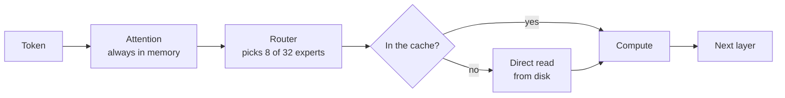

# Expert streaming

Run a 2.67 GB mixture-of-experts language model in about **400 MB of memory** by keeping its experts on
disk and reading each one only when it is needed. Written from scratch in Python, NumPy and a small C
kernel, and checked against Hugging Face Transformers.

A mixture-of-experts model splits each layer's main network into many experts and uses only a few per
token. In [Granite 3.1 1B-A400M](https://huggingface.co/ibm-granite/granite-3.1-1b-a400m-instruct), each of
24 layers has 32 experts and uses 8. The 768 experts are 2.42 GB of the 2.67 GB model.

The approach is inspired by [colibrì](https://github.com/JustVugg/colibri), which streams models of
hundreds of gigabytes. This is an independent implementation for learning and measuring: it shares no
code with colibrì and is far smaller in scope.

## Results

4 virtual cores, 3.9 GB of RAM, no GPU. 64 new tokens from a short prompt, median of 3 fresh processes.

| Expert cache | Policy | Tokens/s | Read per token | Peak memory |
|---|---|---|---|---|
| 64 MB | LFU | 7.5 | 575 MB | 399 MB |
| 256 MB | LRU | 7.2 | 604 MB | 582 MB |
| 256 MB | LFU | 8.0 | 501 MB | 582 MB |
| 512 MB | LRU | 7.2 | 604 MB | 825 MB |
| 512 MB | LFU | 8.8 | 403 MB | 825 MB |
| 1024 MB | LRU | 10.0 | 305 MB | 1314 MB |
| 1024 MB | LFU | 10.7 | 230 MB | 1314 MB |

The cache changes speed, not output: the tests check this for every policy on the small test model. Full data: [bench/speed.json](bench/speed.json).

### LRU is the wrong cache

Share of experts found in the cache, replaying 8 test prompts (512 tokens). `best` knows the future, so it
is a ceiling.

| Cache | LRU | LRU per layer | LFU | Pinned hot set | best |
|---|---|---|---|---|---|
| 64 MB (3%) | 0.0% | 0.0% | 5.3% | 5.0% | 6.4% |
| 256 MB (11%) | 0.0% | 0.0% | 20.2% | 17.8% | 34.1% |
| 512 MB (21%) | 0.0% | 32.2% | 35.9% | 30.5% | 58.3% |
| 768 MB (32%) | 46.2% | 53.3% | 50.4% | 48.9% | 72.4% |
| 1024 MB (42%) | 55.9% | 64.5% | 63.0% | 65.1% | 82.2% |
| 1536 MB (64%) | 81.2% | 83.7% | 83.0% | 84.8% | 93.5% |

Layers run in a fixed cycle, so plain LRU drops each expert just before its layer comes round again, and a
512 MB cache is worth nothing. LFU is the best usable policy up to 512 MB and is the default; above that, LRU
per layer or a pinned hot set is slightly better. Eight separate calibration prompts give the same picture
(the pinned set was learned from those, so it is scored only on the test prompts). Rerun with `python -m bench.simulate`.

### Prefetching guessed right and did not help

Running the next layer's router early predicts 89% of its experts. Reading those ahead made 84-90% of
experts ready when needed (at 256 MB and above), but speed changed by -3% to -1%. Reading and computing
already overlap inside a layer, this disk is fast, and wrong guesses cost extra reads. It may pay off on a
slower disk; that was not tested. Prefetching is off by default.

### A memory bug worth knowing

The first version peaked at 762 MB instead of 399 MB. The conversation buffer was allocated at full size on
the assumption that untouched memory is free, but NumPy requests 2 MB huge pages, so one token made the
whole 402 MB resident.

## Is it correct?

- A tiny random model matches Transformers within 0.001 at all 40 positions, for prompts processed whole, in
  pieces and token by token, under every cache policy ([tests](tests/test_engine.py)).
- On the full model, the most likely token agrees at 154 of 156 positions. The two others are near-ties
  (gaps of 0.10 and 0.12, where 1 to 5 is typical). The reference computes in bf16 and this engine in
  float32, so small differences are expected.
- On two prompts of 1,029 and 1,113 tokens, the next 50 tokens are identical.

## Run it

Linux, Python 3.11 or newer, and a C compiler. The kernel uses AVX2 when the processor has it.

```bash
git clone https://github.com/pkapka-org/expert-streaming && cd expert-streaming
python -m venv .venv && source .venv/bin/activate
pip install -r requirements.txt
scripts/get_model.sh                            # 2.7 GB download, 5.4 GB of disk
python -m expertstream chat --budget-mb 256
python -m expertstream serve --budget-mb 256    # OpenAI-compatible, http://127.0.0.1:8100/v1
```

The server works with OpenAI clients that do not stream, including
[docqa-rag](https://github.com/pkapka-org/docqa-rag):

```bash
OPENAI_BASE_URL=http://127.0.0.1:8100/v1 OPENAI_API_KEY=local LLM_PROVIDER=openai \
    LLM_MODEL=granite-3.1-1b-a400m-instruct python -m docqa ask "..."
```

That combination runs but does not answer well: this 1B model copies the retrieved passages instead of
answering. Transformers produces the same text, so it is the model and not the engine.

## How it works



- [convert.py](expertstream/convert.py) rewrites the checkpoint as one aligned block per expert, so an expert is one read.
- [store.py](expertstream/store.py) holds a fixed number of memory slots. Four threads fill them with
  `O_DIRECT` reads, and compute starts on each expert as it arrives.
- [policies.py](expertstream/policies.py) decides what to drop. The engine and the simulator share this code.
- [kernel.c](expertstream/kernel.c) multiplies bf16 weights directly, so a cached expert takes half the memory of float32.
- [engine.py](expertstream/engine.py) is the model. Long prompts run layer by layer, so each expert is read once per 256 tokens.

## Limitations

- **The disk is virtual.** `O_DIRECT` skips this machine's page cache, but the host may cache too. Measured
  read speed was about 3.6 GB/s; on a slow disk, small caches will be much slower.
- One prompt for speed and 16 for the cache study, on one model. Results for other models may differ.
- Long prompts are slow to start. With 1,029 tokens and a 256 MB cache: 13 to 22 s to the first token, then
  5 to 9 tokens/s, with a 690 MB peak (3 runs).
- Quantising a model this small to 4 bits would make it fit in memory and run faster. Streaming matters when
  the model is too large even then.
- GraniteMoe checkpoints in one bf16 file only. No batching, and the server does not stream.

License: MIT. The model is IBM's, under Apache 2.0, and is not included.
